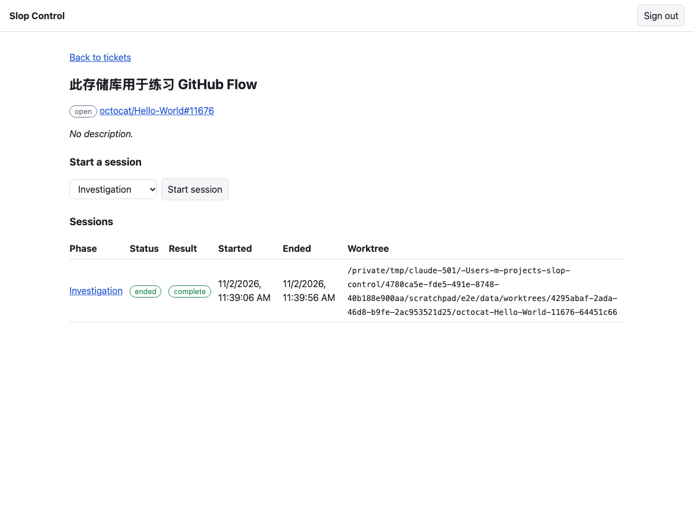
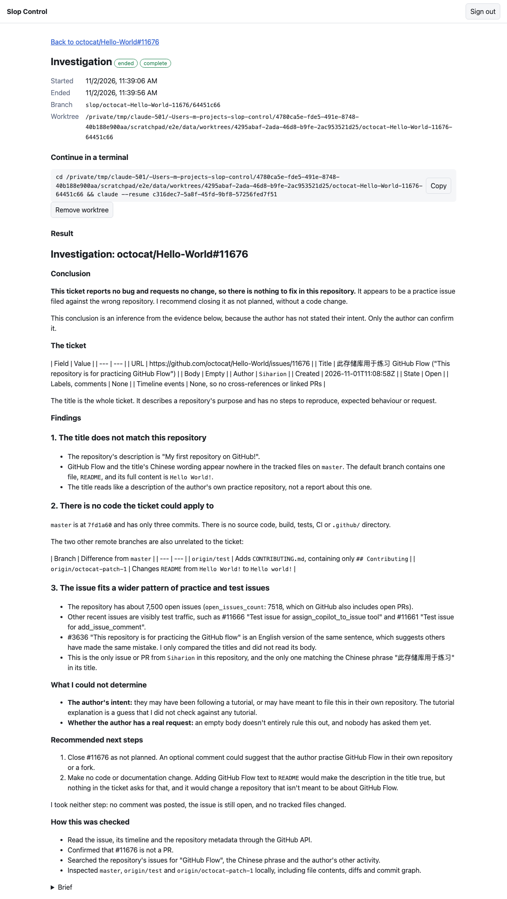
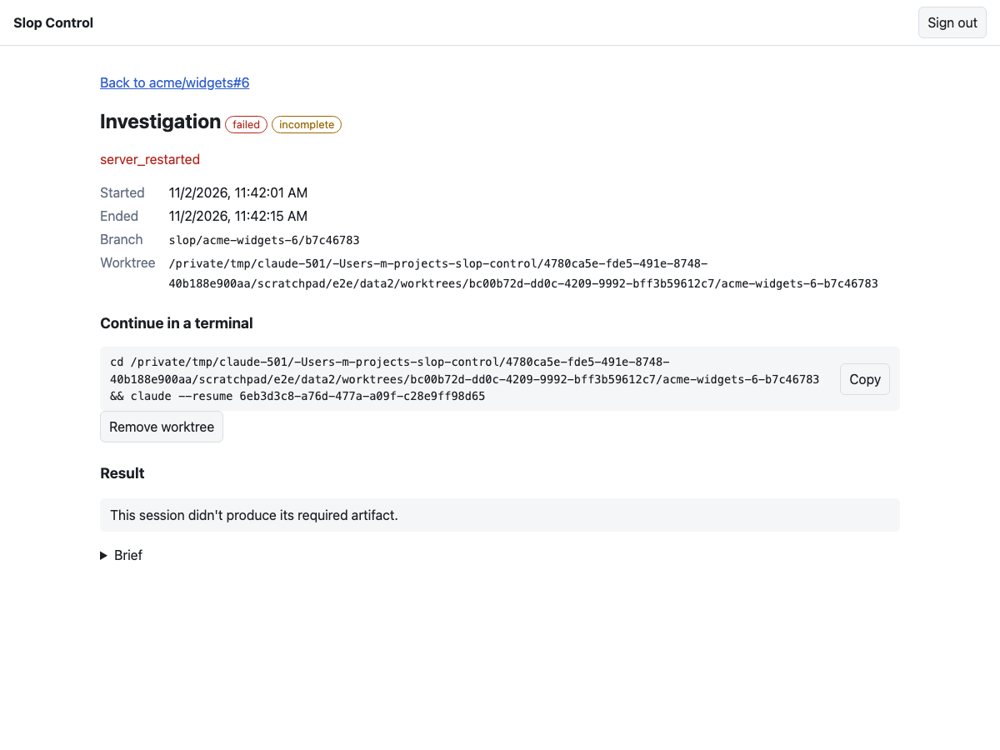
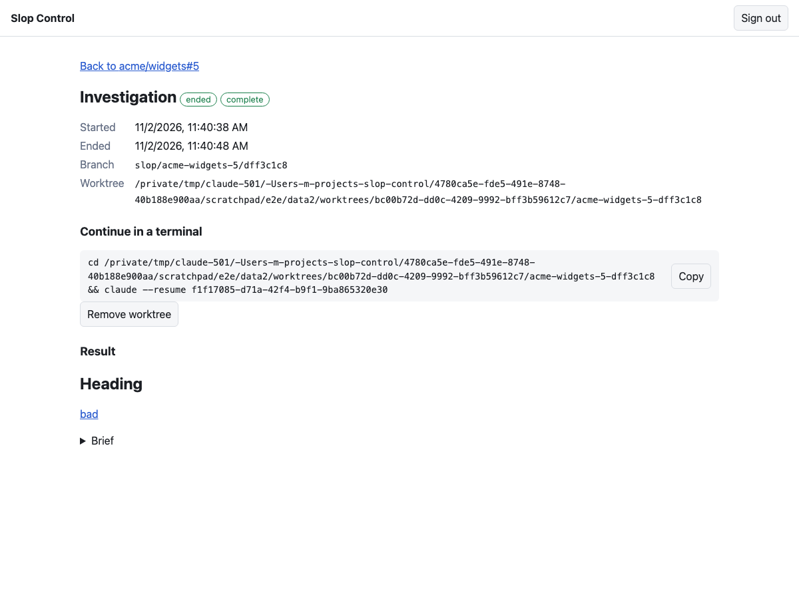

# Sprint 1 end-to-end test report

**Date:** 2026-11-02 · **Branch:** `sprint-01-walking-skeleton` · **Status:** re-tested after fixes

## Verdict

**The sprint goal is met.** A developer can sign in, link a repo, start a real Claude Code session on a GitHub issue, watch its status change live, read its markdown result, and continue it in a terminal.

The first test run found six problems, plus one known risk. All six are fixed and re-tested. The risk stays open: **agents can still act through the host's own `gh` and `git` logins, so keep real sessions on throwaway repos.**

## Findings

| ID | Severity | Finding | Status |
|---|---|---|---|
| F1 | Blocker | Nobody could sign in | Fixed |
| F2 | High | A stop signal could leave the server running and the page out of date | Fixed |
| F3 | High | A server crash left the agent running | Fixed on restart; see the limits below |
| F4 | Medium | After a crash, the page could take about 45 s to recover | Fixed for the dev proxy |
| F5 | Low (downgraded) | The `CLAUDE_` allowlist was too broad | Fixed; first diagnosis was overstated |
| F6 | Medium | Agents use the host's `gh` login | **Open**, needs phase scopes |
| F7 | Low | `npm run dev` needed `apps/server/.env` to exist | Fixed |

### F1: Nobody could sign in

- **Cause:** `enable_signup = false` under `[auth.email]` in `supabase/config.toml` turns off email login altogether. All tests still passed, because they signed their own tokens.
- **Fix:** only the `[auth]` setting stays off. Public sign-up is still rejected with `signup_disabled`.
- **Now guarded:** new tests use real Supabase Auth to sign in, reject a wrong password, and turn away sign-up. With the bug put back on purpose, the sign-in tests fail.

### F2: A stop signal could leave the server running

- **Cause:** while sessions were stopping, the server still accepted connections. A page that reconnected in that window got a stream nothing would close, so the process couldn't exit. Its heartbeats also stopped the page noticing anything was wrong.
- **Fix:** once shutdown starts, new streams and new sessions get a `503`.

| With a session running and a page open | Before | After |
|---|---|---|
| Server exit after SIGTERM | Still running after 8 s, until the client left | About 2 s |
| Page shows `failed` after the restart | Not within 90 s | About 785 ms |

The 2 s exit is the full shutdown grace period, so sessions aren't finishing inside it. It causes no harm, because the agent's process was gone in every run.

### F3: A server crash left the agent running

- **Cause:** after SIGKILL, the Claude Code process moves to parent PID 1 and carries on, along with its tool command.
- **Fix:** on boot, before closing an interrupted session, the server ends any process running the SDK's binary in that worktree, plus the commands under it. It leaves other processes in the folder alone, such as a developer's shell or a `claude --resume` started from the host's install.
- **Re-tested:** the agent was gone once the server came back, in all 3 final runs and in the 14 tracing runs before them.

**Limits:**

- The agent keeps running between the crash and the next boot. If the server never restarts, it runs until it finishes.
- This needs `lsof` and has only run on macOS. If the check fails, the server logs a warning and still boots.

### F4: After a crash, the page could take about 45 s to recover

- **Cause:** the Vite dev proxy never closed the browser's connection when the server died. In 4 of 4 traced crashes, a direct stream failed within 8 ms while the proxied stream stayed open. The page then waited for its 45-second dead-connection check.
- **Why it looked intermittent:** in the fast runs, the page's stream was still connecting when the server was killed.
- **Fix:** the proxy now closes the browser's connection when the server's closes.

| After SIGKILL | Before | After |
|---|---|---|
| Proxied stream notices | Not during the trace | Within 11 ms |
| Page shows `failed` after the restart | About 41 s in 3 of 6 runs | About 785 ms in 7 of 7 runs |

**Limit:** this fixes development only. The server doesn't serve the web app itself yet, so a production setup hasn't been tested; a direct connection already failed fast in the traces.

### F5: The `CLAUDE_` allowlist was too broad

**The first version of this report overstated this.** It suggested `CLAUDE_CODE_MESSAGING_TOKEN` and similar variables were reaching sessions from a parent Claude Code session. That was wrong for those variables: a real session started from a completely clean environment has them too, so Claude Code sets them itself.

- **What was really inherited:** `CLAUDE_CODE_SSE_PORT` was in the first run's list and has now gone.
- **Fix:** the allowlist now names `CLAUDE_CONFIG_DIR` and `CLAUDE_CODE_OAUTH_TOKEN` instead of accepting every `CLAUDE_` variable. An automated test checks that a parent's variables aren't passed on.

### F6: Agents use the host's `gh` login (open)

- **Observed again:** in this run, sessions on the real issue ran `gh issue view` unprompted. I audited all 13 transcripts for `gh`, `curl`, `wget`, `git push`, `ssh`, `npm`, and `pip`, and that was the only network use found. It was read-only.
- **Impact:** the workspace's own token is kept out of sessions, but an agent can still act as the developer through the host's logins. The [S1-04 spike](../spikes/s1-04-headless-resume/) also saw auto mode approve risky commands.
- **Why it isn't fixed here:** blocking `gh` alone would leave `git` and SSH open, and would look safer than it is. This belongs with phase scopes (FR-14), as the spec says. The README now carries the warning.

### F7: `npm run dev` needed `apps/server/.env`

- **Fix:** the server now loads the file only if it exists. The final browser run started with `npm run dev` and no such file.
- **Also added:** a README with the setup steps.

## Results of the final run

### Automated checks

| Check | Result |
|---|---|
| Server tests | 205 passed, 4 smoke tests skipped by default |
| Web tests | 27 passed |
| Claude Code smoke test | 4 passed: readiness, signed-out detection, artifact and resume, and stop |
| Lint and typecheck | Clean |
| Production build | Server built and ran from `dist` |

### Browser runs

| Run | Result |
|---|---|
| Demo script and main flows, started with `npm run dev` | 48 of 48 passed |
| Failures, security, restarts, and concurrency, on the production server build | 89 of 92 passed |

**The 3 failures are mistakes in my check, not product bugs.** They expected the F5 variables to be absent, but Claude Code sets those itself, as explained under F5.

### Demo script

| Step | Result | Evidence |
|---|---|---|
| Sign in and create a workspace | Pass | Wrong password and duplicate name both show clear errors |
| Link a repo | Pass, with a different repo | `octocat/Hello-World` for sessions; this repo was only linked, through its real `git@salmanrf:` SSH alias |
| Open an issue and start an investigation | Pass | Real GitHub data; session in the history 316 ms after the click |
| Status changes to running without a reload | Pass | About 1.1 s after the click, and a worktree appeared on a `slop/` branch |
| Status updates when the session ends, marked complete | Pass | Ended after 51 s and its result rendered |
| History and resume command | Pass | The command, run in a real shell, continued the same session and recalled its file |

I didn't start a session on this repo, because the spec limits real sessions to throwaway repos.

### Live status and restarts

| Check | Result |
|---|---|
| Stream frame to page update | 2 ms for `running`, 5 ms for `ended` |
| Polling | None: 1 API call in a 51 s session, the start request itself |
| Real heartbeat | Arrived at 30.003 s |
| Page recovery after SIGTERM, 2 runs | Showed `failed` with no reload, 784 ms after the server was back |
| Page recovery after SIGKILL, 3 runs | Showed `failed` with no reload, 785 ms after the server was back |
| Recorded reason | `server_restarted` in all 5 |

The time from the runtime reporting a change to the stream frame is covered by an automated test, which requires under 1 s.

### Sessions

| Check | Result |
|---|---|
| Four sessions at once, one per phase | All ended `complete`, each in its own worktree |
| Implementation session | Committed to its own branch; the main checkout and the diff stayed clean |
| Stop | Status became `stopped` and the process ended |
| Removing a worktree with uncommitted work | Warned first; dismissing kept it, and accepting removed it |
| After removal | Branch kept, resume command hidden, result still readable after a reload |
| Claude Code signed out | Clear message with `claude auth login`; no worktree created |
| Claude Code not installed | Clear install message; no worktree created |

### Tickets

| Check | Result |
|---|---|
| Pull requests left out | Pass, compared with GitHub's raw page of 30 items |
| Paging, closed filter, search | Pass, against real GitHub |
| Ticket key with `/` and `#` in a direct URL | Pass |
| Token rejected by real GitHub | `TRACKER_AUTH_FAILED`, shown in the browser |
| Tracker unreachable | Its own message, shown in the browser |

### Access and credentials

| Check | Result |
|---|---|
| All 14 routes with no token, or with the public anon key | `401` on every one |
| Public sign-up | Rejected with `signup_disabled` |
| Browser keys reading tables directly, with data present | Empty for all 4 tables, with the anon key and a signed-in token |
| Another workspace's session | `404` on all 4 session routes |
| A token the real server rejects | Page returned to sign-in |
| Canary GitHub token | Reached the tracker as a header; absent from a real child's environment, the transcripts, the worktrees, the clone's git folder, a database dump, and the server logs |
| Hostile markdown in a real artifact and a ticket body | No script, image, or `javascript:` link created, and the payload didn't run |

## Mistakes in my test scripts

These failed or passed for the wrong reason, and none was a product bug:

| Check | What actually happened |
|---|---|
| Token found in a request URL | My pattern matched `eyJ`, which is also how the page cursor `{"page":2}` encodes. Confirmed by decoding it from a real request. |
| `GITHUB_TOKEN` found in the child's environment | My pattern matched the agent's sentence saying the token wasn't set. |
| Stop and restart checks failed | Claude Code blocks a standalone `sleep`, so the agent never ran it. I switched to a long Python command. |
| F5 variables present in a real session | Claude Code sets them itself. Confirmed from a clean environment. |
| Wrong-password check passed during F1 | It accepted any error. It now requires "Invalid login". |
| Connection-drop check passed | Playwright's offline mode didn't break the open stream, so it proved nothing. Real server restarts replaced it, and that's how F2 and F4 were found. |

## How this was tested

- **Browser:** headless Chromium driven by Playwright, at desktop and 390 px widths.
- **Real:** Supabase Auth and Postgres, Nest, Vite, git, and real Claude Code sessions.
- **GitHub:** the real API without a token for reads. Sessions on real issues ran only on `octocat/Hello-World#11676`, after checking that its body was still empty.
- **Stubbed:** a local GitHub stub served vetted tickets for the riskier runs and the canary test, on a clone with pushing disabled.
- **Console errors:** only the `400`, `401`, `409`, and `422` responses the tests caused on purpose.
- **Server logs:** no `ERROR` lines across 12 server runs. All 27 warnings were the expected `server_restarted` line.

## Not tested

- A restart through `nest start --watch`. The stop-signal tests used the production build.
- Serving the web app without the Vite proxy.
- Linux, including the `lsof` lookup behind the F3 fix.
- Natural token expiry and refresh; the test used a rejected token instead.
- Other browsers, or the dark theme.
- Clicking the **Copy** button. The resume test used the same command text from the API.
- A real classifier denial inside a session, or a host where auto mode is truly unavailable.
- Reading private repos with a valid token.
- Symlinked artifacts on a real session, which have automated coverage only.
- Starting the web app without `VITE_SUPABASE_ANON_KEY`.

## Recommended next steps

1. Add the browser runs to the repo as an opt-in test. They found most of these bugs, and they're still throwaway files outside the repo.
2. Decide whether Sprint 2's phase scopes should also cut off the host's `gh` and `git` logins, which would close F6.
3. Test on Linux before any remote deployment, and check the F3 cleanup there.
