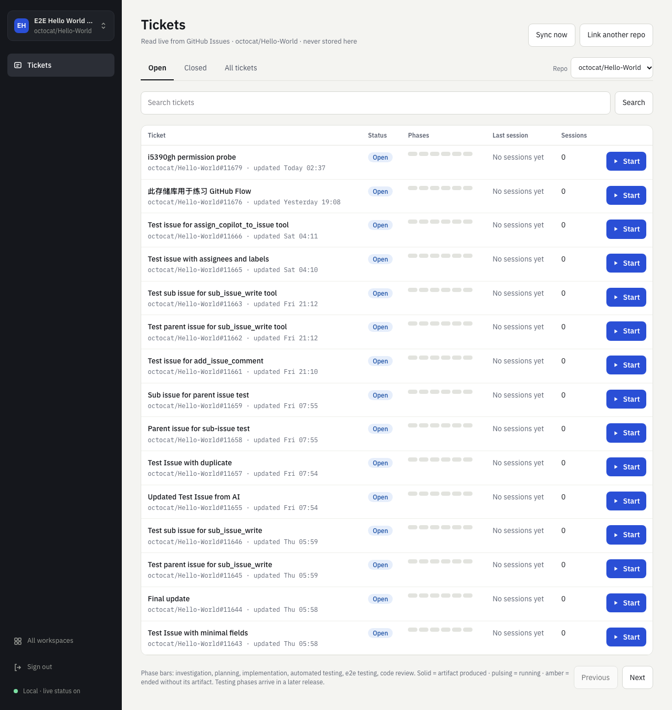
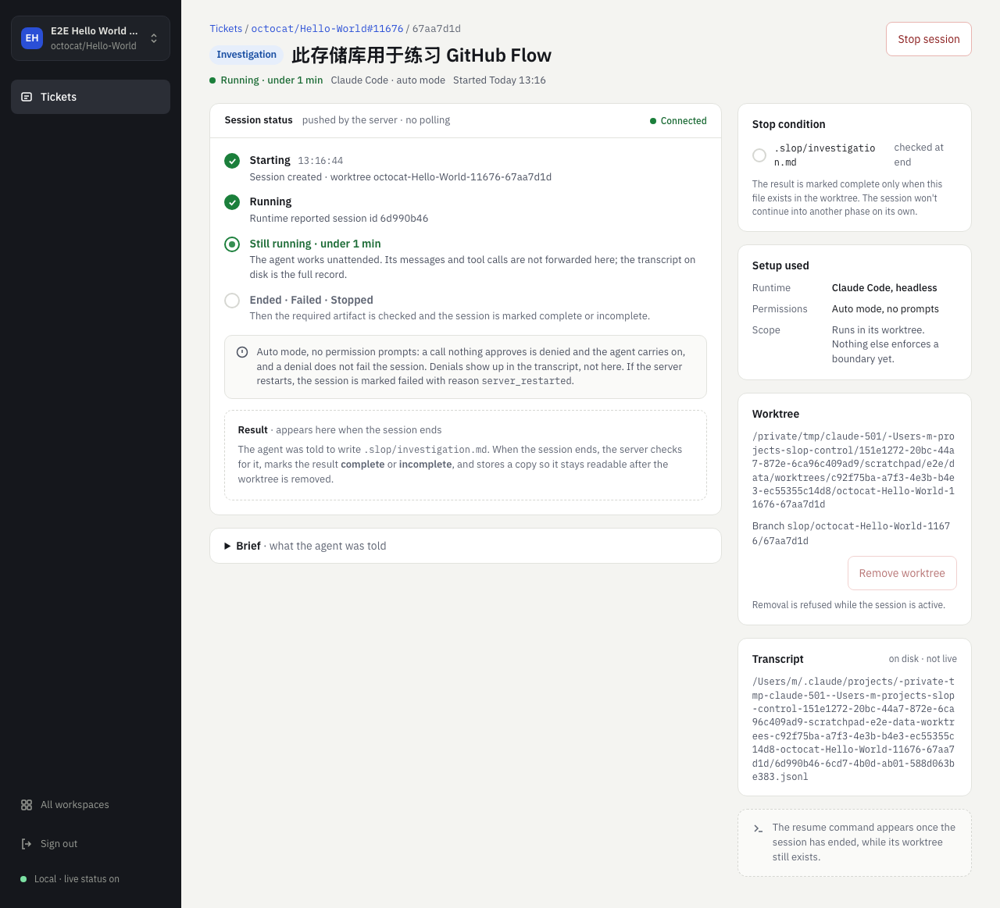
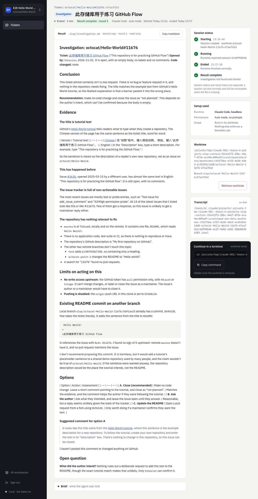
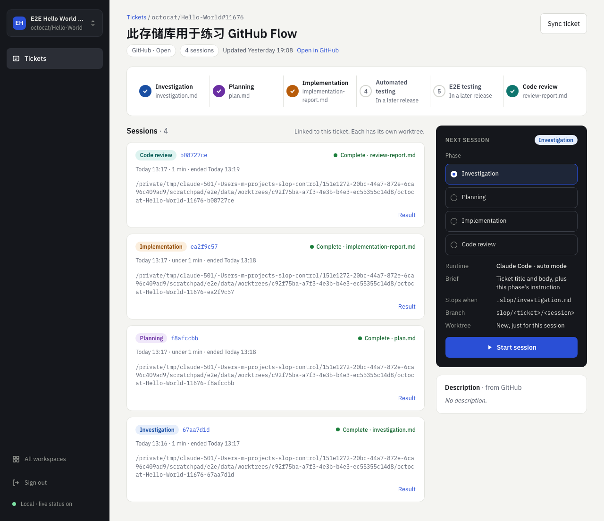
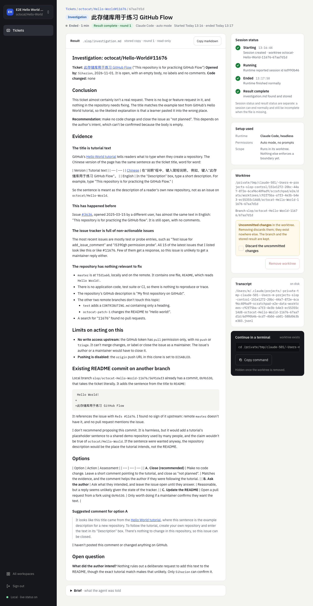
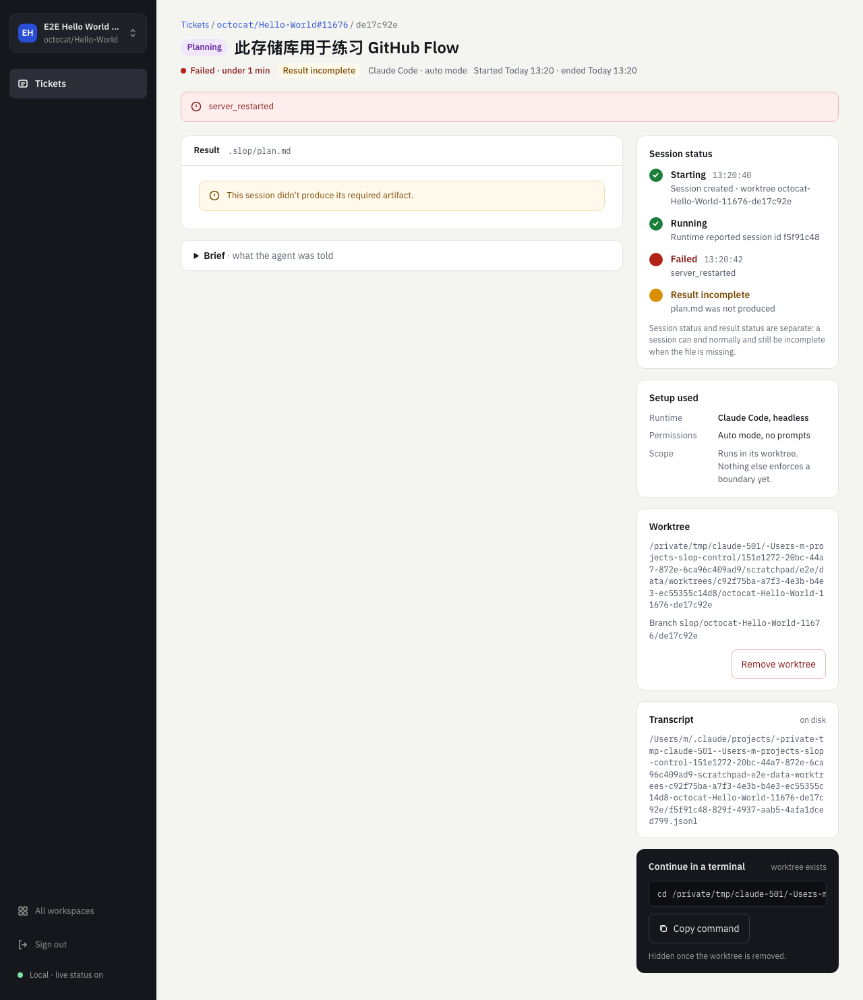
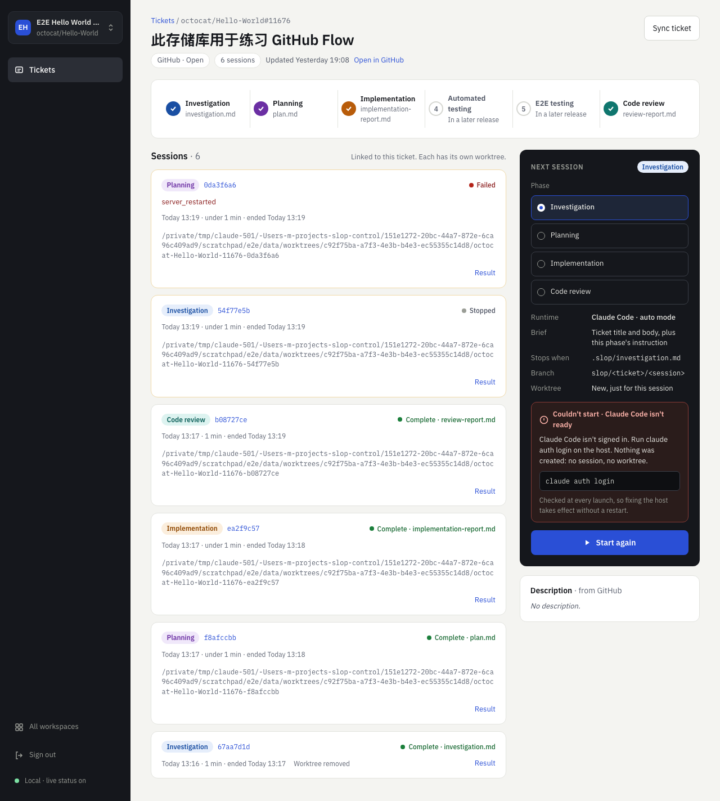
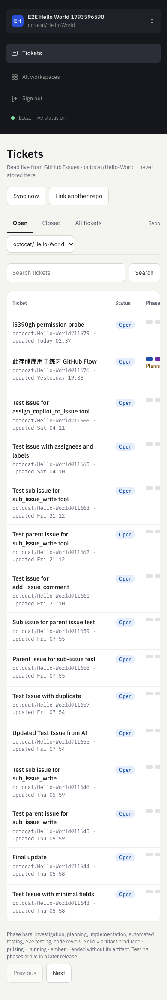

# Sprint 1 UI rework end-to-end test report

**Date:** 2026-11-02 · **Branch:** `sprint-01-walking-skeleton`

## Verdict

**The reworked dashboard works end to end.** All main flows passed on real Supabase, GitHub data, and Claude Code sessions. The run found two regressions from the rework and one older gap, and all three are fixed.

This run is smaller than the [first e2e run](../sprint-01-e2e/), because that run's scripts were throwaway files that no longer exist. See [Not rerun](#not-rerun).

## Findings

| ID | Severity | Finding | Status |
|---|---|---|---|
| U1 | Medium | Error messages lost `role="alert"` in the rework, so screen readers weren't told about them | Fixed |
| U2 | Low | A long workspace name stretched the sidebar from 232 to 296 px | Fixed |
| U3 | Medium | Markdown tables in results showed as raw `\|` text. This predates the rework. | Fixed |
| U4 | Low | On a phone, the Repo label sat apart from its dropdown | Fixed |
| F6 | Medium | Agents use the host's `gh` login | **Open**, needs phase scopes |

**U3 and U4 were fixed after the browser run.** Their fixes were checked with unit tests and in a browser against a mock API, not on the real stack. The screenshots below predate them, so the investigation result still shows raw table text and the phone tickets page still shows the old label.

**F6 was seen again.** Agents ran `gh issue view`, `gh api`, `gh search`, and `gh pr list` unprompted. A pattern search of the 157 Bash commands in the transcripts found no write commands, pushes, or installs, and no `slop/` branch reached GitHub. The search also covered sessions from the first, failed attempt.

## Results

| Check | Result |
|---|---|
| Browser run | 24 of 24 passed |
| Server tests | 205 passed, 4 smoke tests skipped by default |
| Web tests | 46 passed, including new tests for U1 and U3 |
| Lint and typecheck | Clean |

| Area | Result |
|---|---|
| Sign-in | Wrong password shows an error. A rejected token returns to sign-in with the expired banner. |
| Workspaces and repos | Duplicate names and bad paths show clear errors. An empty workspace directs you to link a repo. |
| Tickets | Real GitHub data. Closed tab, paging, and search work, and a key with `/` and `#` opens from a direct URL. |
| Live session | Listed 210 ms after the click. Reached running and ended after about a minute with its result rendered, with no reload. |
| Copy buttons | New coverage. The copied resume command, run in a real shell, continued the session and named the file it wrote. Copy markdown works. |
| Concurrency | Three sessions at once, each in its own worktree. All four phases ended complete. |
| Stop and removal | Stop works. Removing a dirty worktree warns first, then keeps the branch and stored result and hides the resume command. |
| Crash recovery | After SIGKILL, the page showed `failed` 1.3 s after the server answered, with no reload, reason `server_restarted`, and no process left in the worktree. |
| Not ready | With Claude Code signed out, the page shows the fix and creates no session or worktree. |
| Hostile markdown | Script, image, iframe, and `javascript:` link stayed inert. The payload was written straight into the stored artifact row. |
| Phone width | No sideways page scroll on the four main pages. |

## Screenshots

## Mistakes in my test scripts

| Check | What actually happened |
|---|---|
| Session end failed on the first attempt | The check matched the sentence "marks the result complete" and moved on before the session ended. The next step failed for the same reason. |
| Crash recovery passed for the wrong reason | The check matched "Ended · Failed · Stopped", so its screenshot and timing were wrong. That scenario was rerun alone with a strict check, which gave the 1.3 s and the screenshot above. |

The first attempt scored 19 of 24. The other three failures came from U1.

## How this was tested

- **Browser:** headless Chromium driven by Playwright, at desktop and 390 px widths.
- **Real:** Supabase Auth and Postgres, the built Nest server, Vite, git, and Claude Code sessions.
- **GitHub:** the real API with no token. Sessions ran only on `octocat/Hello-World#11676`, after checking that its body was still empty, in a clone with pushing disabled.
- **Failed requests:** only ones the run caused on purpose. The `500`s on the status stream came from the dev proxy while the server was deliberately down. `403`s on `logout?scope=local` came from signing out with a rejected token.
- **Server logs:** no `ERROR` lines.

## Not rerun

These passed in the first run. No server code has changed since, and server tests still cover the behavior at the API level except where noted.

- Route-by-route auth and cross-workspace isolation in the browser.
- The canary token audit of a real session's environment, transcripts, and logs.
- SIGTERM restarts, and the Claude Code not-installed message.

Also not tested: other browsers, Linux, and natural token expiry.
